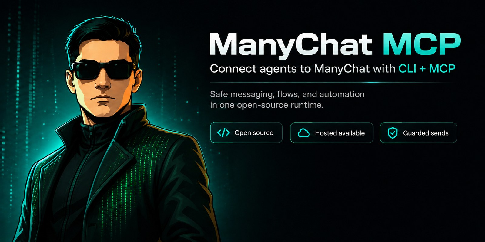
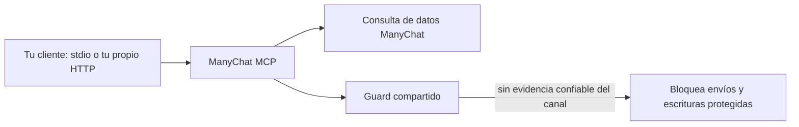

# ManyChat MCP



Servidor MCP y CLI de código abierto para consultar tu propia cuenta de ManyChat y explorar el CRM.

> **0.2.0 ya está publicada.** Permite lecturas y consulta del CRM (búsquedas de suscriptores, etiquetas, campos y datos de la página). **Los envíos, la ejecución de flows y las escrituras protegidas se bloquean.** ManyChat no proporciona evidencia confiable del canal de interacción y esta versión no incluye un proveedor de evidencia. No es un producto operativo de automatización de mensajes: una interacción reciente o el opt-in no habilitan envíos. Una integración futura no forma parte de esta versión.

## Instalar localmente

Paquete publicado: [`mcp-manychat@0.2.0`](https://www.npmjs.com/package/mcp-manychat/v/0.2.0). Release de GitHub: [`v0.2.0`](https://github.com/WIZNEOAI/manychat-mcp/releases/tag/v0.2.0). Requiere **Node 22+** y un plan de ManyChat adecuado para acceder a su API. El software es gratuito bajo AGPL-3.0-or-later; el plan de la plataforma es aparte.

```sh
npx -y mcp-manychat --help
npx -y mcp-manychat mcp serve --transport stdio
```

El segundo comando inicia un servidor MCP local para tu cliente, no un chat interactivo. Configura **tú mismo**, fuera del chat con el agente, `MANYCHAT_API_KEY` en tu entorno de arranque o gestor de secretos del sistema. Consulta [configuración segura por cliente](docs/connect.md). El paquete incluye `manychat` y `manychat-mcp`; no hace falta clonar código. Para fijar esta versión, usa `npx -y mcp-manychat@0.2.0` con los mismos argumentos.

**No se ofrece un gateway público de WIZNEO ni registro hosted.** Usa stdio local o [aloja tu propio servidor remoto](docs/self-host.md). El despliegue Docker/HTTP está documentado pero **sin verificar**; necesitas tu propia infraestructura y validación de seguridad.

## Configuración segura para cada cliente

Nunca pegues una API key en el chat, prompts, código fuente, valores literales del config ni argumentos del CLI. No le pidas al agente leer archivos de secretos ni volcar el entorno. Tú preparas el secreto localmente; el agente configura solo comandos/argumentos y referencias o paso de variables por nombre. Si compartes una key por error, rótala sin repetirla.

| Cliente | Configuración sin secretos literales |
|---|---|
| Claude Code | [Registro de usuario; entorno heredado](docs/clients/claude-code.md) |
| Claude Desktop | [Config sin keys; entorno de arranque gráfico preparado](docs/clients/claude-desktop.md) |
| Cursor | [Config de usuario; entorno heredado](docs/clients/cursor.md) |
| Codex | [Paso explícito de la variable por nombre](docs/clients/codex.md) |
| OpenCode | [Servidor local; entorno heredado](docs/clients/opencode.md) |
| Hermes | [Referencia de variable, nunca un valor literal](docs/clients/hermes.md) |
| VS Code | [Config MCP de usuario; entorno heredado](docs/clients/vscode.md) |
| n8n | [Tu endpoint HTTP; almacén de credenciales de n8n](docs/clients/n8n.md) |

Las apps gráficas no necesariamente heredan un `export` de tu terminal, especialmente si ya están abiertas. Usa un lanzador conectado al gestor de secretos o reinicia desde el entorno preparado. Si el cliente filtra variables del subproceso, consulta su guía para referencias/paso de entorno; no copies la key al config como solución.

### Pégale este texto sin secretos a tu agente

```text
Configura ManyChat MCP para mi cliente usando docs/connect.md y su guía específica. Pídeme preparar MANYCHAT_API_KEY en mi entorno de arranque o gestor de secretos fuera de este chat, y espera confirmación sin solicitar el valor. Nunca me pidas pegar la key, leer/copiar su valor, abrir archivos de secretos, volcar el entorno ni colocar credenciales en configs literales o argumentos del CLI. Configura solo npx con argumentos ["-y", "mcp-manychat", "mcp", "serve", "--transport", "stdio"], heredando el entorno o usando referencias documentadas. Con mi autorización, verifica solo get_page_info ({}). 0.2.0 está publicada para lecturas/consulta del CRM; los envíos y escrituras protegidas se bloquean. No envíes ni modifiques datos como prueba. Para un remoto, usa docs/self-host.md en mi propia infraestructura; no crees ni despliegues nada sin autorización separada. No se ofrece un gateway público de WIZNEO.
```

Para n8n, configura tu propio endpoint HTTPS `/mcp` y la credencial `X-ManyChat-API-Key` administrada por n8n. Las peticiones HTTP con header **nunca** toman una key del entorno del servidor. OAuth es otro modo de autenticación, excluyente con el header; consulta la guía.

## Qué hace 0.2.0



Ejemplos de solo lectura, una vez preparado tu entorno:

```sh
npx -y mcp-manychat page info
npx -y mcp-manychat tags list
npx -y mcp-manychat subscribers get ID
npx -y mcp-manychat validate ID
```

Consulta solo contactos autorizados. `validate_message` / `validate ID` leen contexto, no envían mensajes. Espera `CHANNEL_UNKNOWN` si falta evidencia confiable del canal. Un bloqueo **no** etiqueta automáticamente al lead ni avisa a una persona. Cambiar etiquetas/campos puede disparar automatizaciones: las escrituras protegidas también se bloquean. No se promete recuperación ni derivación automática.

### Canales y límites

| Canal | Qué se puede afirmar |
|---|---|
| WhatsApp | Los datos pueden exponer identificadores y opt-in. No se prometen envíos operativos; la interacción actual no prueba el canal. `sendContent` no envía plantillas aprobadas de WhatsApp fuera de la ventana estándar. |
| Instagram / Messenger | Los datos pueden exponer identificadores. No se prometen envíos operativos. Se bloquean message tags obsoletos; HUMAN_AGENT es atención humana, no automatización, y requiere la aprobación aplicable de Meta. |
| TikTok / Telegram / SMS / Email | No se prometen envíos. Conectar la cuenta no demuestra compatibilidad de sus canales. |

Una marca de tiempo de 24 horas, opt-in o supuesto origen publicitario no sustituye evidencia confiable del canal. Consulta [política y fuentes oficiales](docs/policy.md).

### Herramientas anunciadas no equivalen a mutaciones habilitadas

El servidor anuncia 28 herramientas, incluidas acciones de envío/escritura que permanecen protegidas/bloqueadas:

`get_subscriber`, `find_subscriber_by_email`, `find_subscriber_by_phone`, `find_subscriber_by_name`, `create_subscriber`, `update_subscriber`, `list_tags`, `create_tag`, `add_tag_to_subscriber`, `add_tag_to_subscriber_by_name`, `remove_tag_from_subscriber`, `remove_tag_from_subscriber_by_name`, `list_custom_fields`, `create_custom_field`, `set_custom_field`, `set_custom_field_by_name`, `set_custom_fields_bulk`, `list_flows`, `send_flow`, `send_text_message`, `send_content`, `validate_message`, `get_page_info`, `list_bot_fields`, `set_bot_field`, `list_growth_tools`, `list_otn_topics`, `health_check`.

## Servidor propio y límites de seguridad

Consulta [self-host](docs/self-host.md), [arquitectura](docs/architecture.md) y [clientes](docs/connect.md).

- Docker, Render y OAuth con Redis real **no se han verificado** en despliegue. La guía no es una garantía de despliegue.
- HTTP en producción exige contadores Redis compartidos y configuración de proxies confiables. La memoria es solo para desarrollo. Usa HTTPS, Redis con TLS/ACL y orígenes exactos; nunca registres headers de credenciales.
- OAuth con Redis exige además `OAUTH_STORE=redis`, `MCP_BASE_URL` HTTPS y `OAUTH_ENC_KEY` (64 caracteres hexadecimales / 32 bytes aleatorios), guardados en el gestor de secretos del servidor, no en configs de clientes. Los registros usan AES-256-GCM y los identificadores SHA-256. OAuth en memoria no sobrevive reinicios ni se comparte entre instancias.
- HTTP: 120 peticiones/IP/minuto, 60/hash de key/minuto, body de 32 KB y timeout de upstream de 20 s. `/health` no tiene límite de peticiones. MCP no usa sesiones ni afinidad de instancia.
- `MCP_REMOTE_AUTH` elige `manychat_header` (predeterminado) u `oauth`, excluyentes. `PORT=3000`, `HOST=0.0.0.0`; `LOG_LEVEL`: `debug`, `info`, `warn`, `error` (predeterminado `info`). Producción exige `TRUST_PROXY_CIDRS` o `TRUST_PROXY_HOPS` (1–16), nunca ambos. Confiar por saltos solo es seguro si la entrada es exclusiva y bloquea rutas directas o más cortas.
- `MANYCHAT_ALLOW_HUMAN_AGENT=1` es una opción exclusiva del servidor, apagada por defecto; no demuestra autoría humana ni aprobación de Meta ni aporta evidencia del canal. Ninguna herramienta acepta `human_agent`.
- `send_content` modela texto/imagen/video/audio, no cards/botones/acciones de Dynamic Content. Un flow es opaco: el guard no inspecciona mensajes posteriores. No hay reintentos de POST ni idempotencia; `promotional` no clasifica texto. Estos detalles de esquema no habilitan envíos.

## Pruebas y releases

`pnpm lint`, `pnpm typecheck`, `pnpm test`, `pnpm build` y `pnpm test:mutation` no necesitan una cuenta ManyChat. Permiten sockets locales pero bloquean fetch externo. El smoke opcional `pnpm smoke:readonly` usa `MANYCHAT_API_KEY` y `MANYCHAT_SMOKE_SUBSCRIBER_NAME` preparados localmente; realiza tres GET sin imprimir datos de contactos. Requiere autorización del dueño de la cuenta.

Consulta [releases](docs/releasing.md) para versiones futuras. Este cambio documental no cambia la versión ni publica npm. Las firmas del registro no son procedencia de build: no la afirmes sin verificar una atestación del release exacto.

La licencia sigue siendo **AGPL-3.0-or-later**. Se conserva la atribución en [NOTICE.md](NOTICE.md) y [LICENSE](LICENSE). Proyecto no oficial, sin afiliación con ManyChat, Inc.
