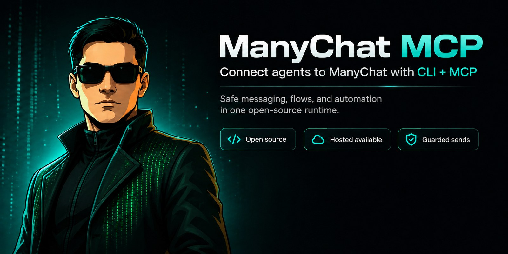
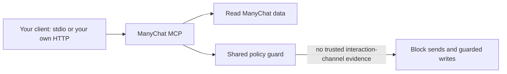

# ManyChat MCP



Open-source MCP server and CLI for reading your own ManyChat account and inspecting CRM data.

> **0.2.0 is published.** It supports reads and CRM inspection (subscriber searches, tags, fields and page data). **Sends, flow dispatch and guarded CRM writes fail closed.** ManyChat does not provide trusted interaction-channel evidence, and no evidence provider is shipped. This is not a working messaging automation product; a recent interaction or opt-in does not unlock sending. A future evidence integration is not part of this release.

## Install locally

Published package: [`mcp-manychat@0.2.0`](https://www.npmjs.com/package/mcp-manychat/v/0.2.0). GitHub release: [`v0.2.0`](https://github.com/WIZNEOAI/manychat-mcp/releases/tag/v0.2.0). Requires **Node 22+** and a suitable paid ManyChat plan for API access. The software is free under AGPL-3.0-or-later; platform plans are separate.

```sh
npx -y mcp-manychat --help
npx -y mcp-manychat mcp serve --transport stdio
```

The second command starts a local MCP server for your client, not an interactive chat. Prepare `MANYCHAT_API_KEY` **yourself**, outside agent chat, in your local launch environment or OS keychain/secret store. See [safe client setup](docs/connect.md). The package exposes `manychat` and `manychat-mcp` binaries; no source checkout is required. To pin this release, use `npx -y mcp-manychat@0.2.0` with the same arguments.

**No public WIZNEO gateway or hosted signup is offered.** Choose local stdio or [self-host your own remote](docs/self-host.md). Docker/HTTP deployment is documented but **unverified**; running a remote requires your own infrastructure and security validation.

## Safe setup for your client

Never paste a ManyChat key into an agent chat, prompt, source file, client config literal or CLI argument. Never ask an agent to read secret files or dump its environment. The user prepares the secret locally; the agent configures only command/arguments and environment-variable references or passthrough. If a key is accidentally shared, rotate it without repeating it.

| Client | Secret-free setup |
|---|---|
| Claude Code | [User-level registration; inherited environment](docs/clients/claude-code.md) |
| Claude Desktop | [Config without key values; prepared GUI launch environment](docs/clients/claude-desktop.md) |
| Cursor | [User-level config; inherited environment](docs/clients/cursor.md) |
| Codex | [Explicit variable-name passthrough](docs/clients/codex.md) |
| OpenCode | [Local server; inherited environment](docs/clients/opencode.md) |
| Hermes | [Variable reference, never a literal key](docs/clients/hermes.md) |
| VS Code | [User MCP config; inherited environment](docs/clients/vscode.md) |
| n8n | [Your own HTTP endpoint; n8n credential store](docs/clients/n8n.md) |

GUI clients may not inherit a terminal export, especially if already running. Use a local secret-manager launcher or restart from the prepared environment. If your client filters subprocess variables, consult its installed-version guide for documented passthrough/reference support; do not work around it by copying the key into config.

### Paste this secret-free request to your agent

```text
Set up ManyChat MCP for my client using the official docs/connect.md and its client guide. Ask me to set MANYCHAT_API_KEY in my own launch environment or OS secret store outside this chat, then wait for confirmation without requesting the value. Never ask me to paste the key, read/copy its value, open secret files, dump the environment, or put a credential in config literals or CLI arguments. Configure only npx with arguments ["-y", "mcp-manychat", "mcp", "serve", "--transport", "stdio"], using environment inheritance or the documented client variable-reference mechanism. With my approval verify only get_page_info ({}). 0.2.0 is published for reads/CRM inspection; sends and guarded writes fail closed. Do not send or mutate data as a setup test. For a remote, use docs/self-host.md on my own infrastructure; do not provision or deploy without separate approval. No public WIZNEO gateway is offered.
```

For n8n, use your own HTTPS `/mcp` endpoint and an `X-ManyChat-API-Key` credential managed by n8n. Header-auth HTTP requests **never** fall back to a server environment key. OAuth is a separate, mutually exclusive auth mode; see the guide.

## What 0.2.0 does



Read-only CLI examples, after you prepare the local environment:

```sh
npx -y mcp-manychat page info
npx -y mcp-manychat tags list
npx -y mcp-manychat subscribers get ID
npx -y mcp-manychat validate ID
```

Read only contacts you are authorized to access. `validate_message` / `validate ID` inspect subscriber context, not send a message. Expect `CHANNEL_UNKNOWN` when trusted channel evidence is absent. A blocked action does **not** automatically tag a lead or notify a human. Guarded tag/field writes can trigger automations, so they are blocked too. No recovery or automatic handoff is promised.

### Channel limits

| Channel | What can be claimed |
|---|---|
| WhatsApp | Data may expose identifiers and opt-in. No working send support promised; current interaction data does not prove channel. ManyChat `sendContent` cannot send approved WhatsApp templates outside the standard window. |
| Instagram / Messenger | Data may expose identifiers. No working send support promised. Deprecated message tags are blocked; HUMAN_AGENT is human support, not automation, and requires applicable Meta approval. |
| TikTok / Telegram / SMS / Email | No sending support promised. Connecting an account is not evidence of channel support. |

A 24-hour timestamp, opt-in, or claimed ad-origin exception cannot replace trusted channel evidence. See [policy and official sources](docs/policy.md).

### Advertised tools are not enabled mutations

The server advertises 28 tools, including sends and writes whose invocation remains guarded/blocked in this release:

`get_subscriber`, `find_subscriber_by_email`, `find_subscriber_by_phone`, `find_subscriber_by_name`, `create_subscriber`, `update_subscriber`, `list_tags`, `create_tag`, `add_tag_to_subscriber`, `add_tag_to_subscriber_by_name`, `remove_tag_from_subscriber`, `remove_tag_from_subscriber_by_name`, `list_custom_fields`, `create_custom_field`, `set_custom_field`, `set_custom_field_by_name`, `set_custom_fields_bulk`, `list_flows`, `send_flow`, `send_text_message`, `send_content`, `validate_message`, `get_page_info`, `list_bot_fields`, `set_bot_field`, `list_growth_tools`, `list_otn_topics`, `health_check`.

## Self-hosting and security limits

See [self-host your own remote](docs/self-host.md), [architecture](docs/architecture.md) and [client setup](docs/connect.md).

- Docker, Render and OAuth with real Redis have **not** been verified in a real deployment. A guide is not a deployment guarantee.
- Production HTTP requires shared Redis counters and trusted ingress configuration. Memory stores are development-only. Use HTTPS, Redis TLS/ACLs and exact allowed origins; do not log credential headers.
- OAuth Redis storage additionally requires `OAUTH_STORE=redis`, an HTTPS `MCP_BASE_URL`, and `OAUTH_ENC_KEY` (64 hexadecimal characters / 32 random bytes). Keep these in the server secret manager, never client config. Records use AES-256-GCM; credential identifiers use SHA-256. In-memory OAuth does not survive restarts or span instances.
- HTTP defaults: 120 requests/IP/minute, 60/credential-hash/minute, 32 KB body cap and 20 s upstream deadline. `/health` bypasses rate limits. MCP is stateless, with no instance affinity.
- `MCP_REMOTE_AUTH` selects `manychat_header` (default) or `oauth`, exclusively. `PORT=3000`, `HOST=0.0.0.0`; `LOG_LEVEL` accepts `debug`, `info`, `warn`, `error` (default `info`). Production requires `TRUST_PROXY_CIDRS` or `TRUST_PROXY_HOPS` (1–16), never both. Hop trust is safe only with an exclusive ingress and blocked direct/shorter paths.
- `MANYCHAT_ALLOW_HUMAN_AGENT=1` is a server-only opt-in, off by default, not evidence of human authorship or Meta approval. It does not supply missing channel evidence. No tool accepts `human_agent`.
- `send_content` models text/image/video/audio, not Dynamic Content cards/buttons/actions. Flows are opaque: a dispatch guard cannot inspect later ManyChat messages. POSTs are not retried or idempotent; `promotional` is not a text classifier. These schema details do not unlock sends.

## Tests and releases

No ManyChat account is needed for `pnpm lint`, `pnpm typecheck`, `pnpm test`, `pnpm build` or `pnpm test:mutation`. Tests allow local sockets but block external fetches. The separate, optional `pnpm smoke:readonly` needs locally prepared `MANYCHAT_API_KEY` and `MANYCHAT_SMOKE_SUBSCRIBER_NAME`; it makes three GETs and prints no subscriber data. Never use it without account-owner approval.

See [releasing](docs/releasing.md) for future releases. This documentation change does not bump the version or publish npm. Registry signatures are not build provenance; do not claim provenance unless the exact release has a verified attestation.

License remains **AGPL-3.0-or-later**, with upstream attribution preserved in [NOTICE.md](NOTICE.md) and [LICENSE](LICENSE). Unofficial project; not affiliated with ManyChat, Inc.
